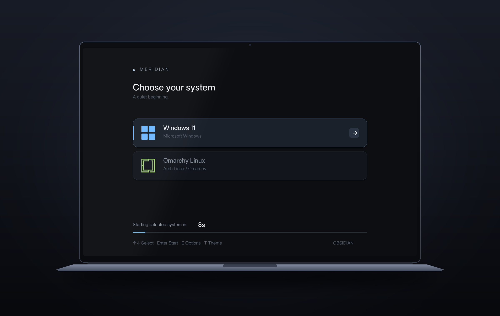
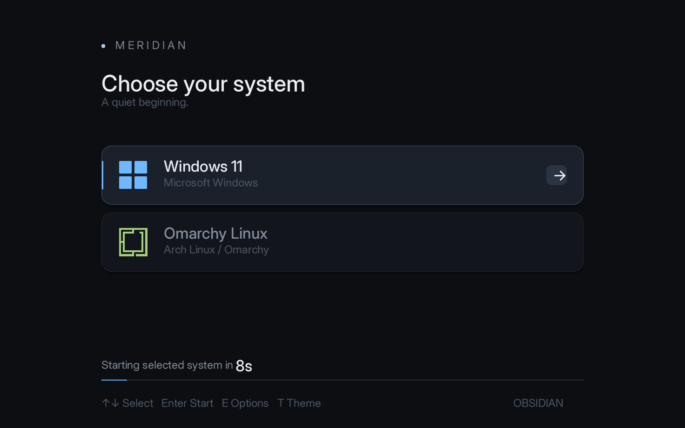
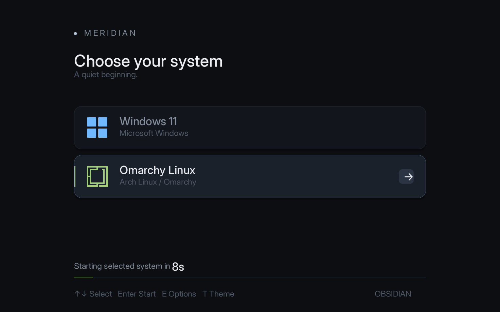
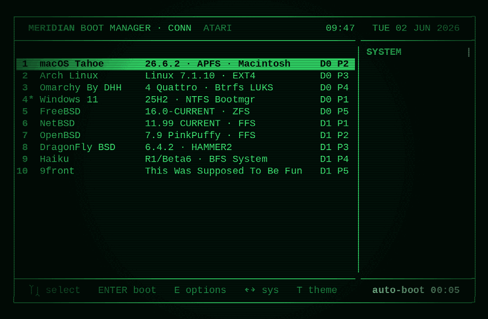
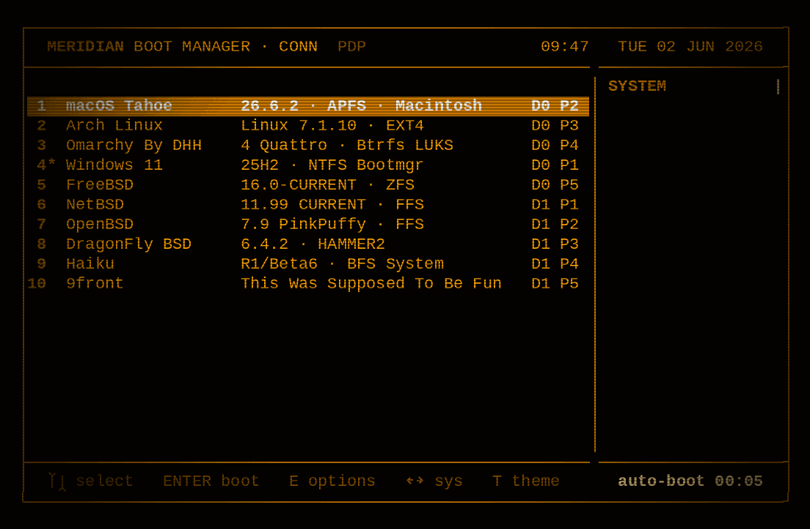
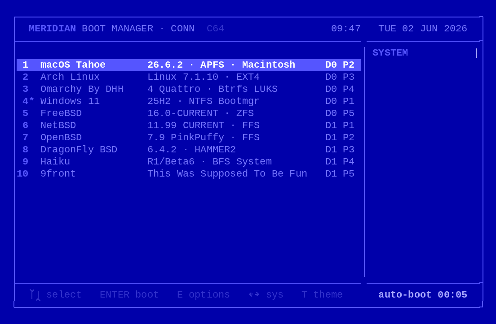

# meridian-woa

[English](README.md) · [简体中文](README.zh-CN.md) · **繁體中文**

給 **Windows on Arm** 筆電用的圖形化雙系統開機選單：在 Snapdragon X 機器上開機時選擇進入 Windows 11 或 Linux，體驗類似 OpenCore。

`meridian-woa` 是 [**Meridian**](https://github.com/seuros/meridian) 的分支。Meridian 是 [seuros](https://github.com/seuros) 開發的 UEFI 開機管理程式，真正的核心工作都是它完成的。本分支做的事是：讓它能在高通 ARM64 韌體上正常開機，加上一套依螢幕原生解析度繪製的主題，以及為 Windows 11 + Omarchy 雙系統準備的安裝指令碼。



<sub>示意圖：參照聯想 Yoga Slim 7x 外觀繪製的筆電。螢幕內容是算繪器依螢幕原生解析度 2944×1840 輸出的真實畫面，不是手繪的。</sub>

## 狀態

| | |
| --- | --- |
| 測試機型 | 聯想 Yoga Slim 7x 14Q8X9（83ED），Snapdragon X Elite，2944×1840 螢幕 |
| 系統 | Windows 11 ARM64 + [Omarchy](https://omarchy.org)（Arch Linux，Limine，LUKS + Btrfs） |
| 韌體 | 需關閉安全開機（Secure Boot），本建置未簽署 |
| 其他 Snapdragon X 筆電 | 很可能可以使用，但尚未測試，歡迎回報 |

## 螢幕截圖

延續上游的做法：**這裡的截圖都不是效果圖**（只有外面那台筆電是畫的）。Meridian 的 Conn 算繪器可以編譯成一般的電腦程式，用模擬的掃描結果算繪一個畫面，再把影格緩衝區存成 PNG。實機上用的是同一套程式碼，透過 GOP 畫到螢幕上。

**Obsidian** 是本分支的預設主題，依螢幕原生解析度繪製：

| 選取 Windows 11 | 選取 Omarchy |
| --- | --- |
|  |  |

原尺寸畫面：[Windows](docs/media/obsidian-windows-2944.png) · [Omarchy](docs/media/obsidian-omarchy-2944.png)（2944×1840）。

Meridian 內建的三個主題都還在。在選單中按 `T` 可以在 ATARI、PDP、C64 之間切換（截圖取自上游）：

| ATARI | PDP | C64 |
| --- | --- | --- |
|  |  |  |

## 本分支改了什麼

### 1. ARM64 韌體上的無限重新開機（真正的修正）

原版 Meridian 編譯成 AArch64 後，在 Yoga Slim 7x 上一開機就回到廠商 logo，無限循環。原因在 `platform/reset_reason.c` 的 `MrdDetectBootCause()`：在非 Apple 機器上，它會讀取**實體位址 `0x0`–`0x1000` 與 `0xF0000`–`0x100000`** 來尋找 coreboot 表格，找不到再透過 **x86 的 I/O 連接埠**讀取 ACPI PM1。這兩種做法都是 PC BIOS 時代的慣例。ARM64 的 UEFI 不對應第 0 頁（用來攔截空指標），也沒有連接埠 I/O，所以第一次讀取就觸發同步例外，高通韌體隨即重設整台機器。

在 AArch64 上，這些偵測程式碼不再編譯，開機原因記為「未知」。這個值原本只用來寫一行記錄，所以對其他功能沒有影響。

定位方法是把每一步的進度顯示在螢幕上，同時寫進 ESP 上的檔案。在這台機器的韌體上，EFI 程式在作業系統啟動之前寫入的 NVRAM 變數重新開機後**沒有保存下來**，所以用變數記錄進度什麼也看不到。另外用一個最小的探針程式確認了韌體能正常載入並啟動這個檔案（`LoadImage` 與 `StartImage` 都回傳 `EFI_SUCCESS`）。兩次實機測試都停在同一步。

### 2. Obsidian：依原生解析度繪製

Conn 的所有主題都畫在固定的 1104×723 畫布上，再用雙線性內插放大。在 2944×1840 的螢幕上約等於放大 2.5 倍，文字會變得模糊。現在 Obsidian 直接依 GOP 回報的解析度繪製，再 1:1 顯示到螢幕上：

- 版面仍以 1104×723 為設計稿，依螢幕尺寸縮放，左右不再有黑邊
- Inter 字型依 1×、1.5×、2×、2.5×、3× 五種倍率烘焙（`conn/tools/bake_obsidian_font.py`），執行時自動選用最接近的一組
- 圓角具反鋸齒；滑鼠點擊依螢幕實際像素判斷
- 80×25 的復古主題仍沿用上游的畫布與縮放方式

在測試機上實測，2944×1840 下重繪流暢。因為加入大字級字形，EFI 檔案增加到約 3.3 MB。

### 3. 交給韌體開機項目，而不是跨 ESP 鏈式載入

Windows 與 Omarchy 各自保留自己的 ESP。兩個選單項目不直接跨分割區載入，而是交給韌體裡本來就能正常開機的開機項目（`firmware_bootnum`）：Windows Boot Manager 與 Limine。Limine 恢復為 `quiet` + `timeout: 1`，所以選 Omarchy 後會直接進入系統，不會再出現第二個選單。需要時在那 1 秒內按任意鍵，仍然可以開啟 Limine 的快照選單。

### 4. 針對 Windows 11 + Omarchy 的工具

| 檔案 | 在哪裡執行 | 用途 |
| --- | --- | --- |
| `woa/Meridian-Boot.ps1` | Windows（系統管理員） | `Install`（用一次性的 `BootNext` 測試，不變更 `BootOrder`）、`Promote` / `Demote`、`Status`、`Remove`、`Tidy`（恢復安靜模式的 Limine） |
| `woa/meridian-guard.sh` | Omarchy（`sudo`） | systemd 服務，每次開機與關機時把 *Meridian Obsidian* 放回 `BootOrder` 第一位，否則 Limine 或 `efibootmgr` 更新後會把預設開機項目改回去 |
| `woa/config.conf` | ESP | 只有 Windows 11 與 Omarchy 兩項，倒數 8 秒，隱藏工具項目（`showtools none`） |

## 安裝

> [!WARNING]
> 這會改變筆電的開機方式。請先閱讀[還原](#還原)，準備好 Windows 復原隨身碟，並確認手邊有 BitLocker 復原金鑰。

1. **前提：** 關閉安全開機（Secure Boot）；Windows 與 Linux 各自都能正常開機。
2. **準備 `Meridian.efi`：** 從 Releases 下載或自行[建置](#建置)，放到 `woa\Meridian.efi`。安裝指令碼會自動找出兩個 ESP（依 `bootmgfw.efi` 與 `limine.conf` 判斷），以及 Windows Boot Manager 與 Limine 的 `Boot####` 編號。用 `-Action Status` 可以查看偵測結果；必要時可以用 `-WindowsEsp`、`-LinuxEsp`、`-WindowsBootNum`、`-LinuxBootNum` 手動指定。
3. **測試（只影響下一次開機）：** 在系統管理員 PowerShell 中執行：
   ```powershell
   powershell -ExecutionPolicy Bypass -File .\woa\Meridian-Boot.ps1 -Action Install
   ```
   重新開機後選 **Windows 11**。再執行一次 `Install`，重新開機後選 **Omarchy**。如果出了問題，下次開機會依原本的開機順序啟動。
4. **設為預設：** 兩個系統都能透過它正常開機後執行：
   ```powershell
   powershell -ExecutionPolicy Bypass -File .\woa\Meridian-Boot.ps1 -Action Promote
   powershell -ExecutionPolicy Bypass -File .\woa\Meridian-Boot.ps1 -Action Tidy
   ```
5. **在 Omarchy 中執行一次：**
   ```bash
   sudo bash /boot/meridian-guard.sh
   ```

## 還原

- 開機時按 **F12**（聯想開機選單），選擇 *Windows Boot Manager* 或 *Limine*。
- `Meridian-Boot.ps1 -Action Demote` 還原原本的 `BootOrder`；`-Action Remove` 刪除開機項目與 `\EFI\Meridian`。Windows 與 Limine 的開機檔案始終不會被修改。
- 在 Omarchy 中：`sudo bash /boot/meridian-guard.sh --remove`。

## 建置

Meridian 是一個 EDK2 套件，建置方式請見 [README.upstream.md](README.upstream.md)。本分支是在 Windows 11 ARM64 上用 [llvm-mingw](https://github.com/mstorsjo/llvm-mingw) 直接建置的（`CLANGDWARF`、`AARCH64`、`RELEASE`）。在 Windows 上建置時要注意：

- `edk2/Conf/build_rule.txt`：把 `Trim` 改成以 `"$(PYTHON_COMMAND)" ".../Trim/Trim.py"` 的形式呼叫。在這台機器上，`make` 找不到 `Trim.bat` 這個包裝指令碼。
- 截圖由電腦端算繪程式產生：`make -C conn render-obsidian W=2944 H=1840`（`make -C conn obsidiantest` 執行它的自我測試）。

## 儲存庫結構

| 路徑 | 內容 |
| --- | --- |
| *（根目錄）* | 包含本分支修改的 Meridian 原始碼（GPL-3.0-or-later） |
| `woa/` | Windows 安裝指令碼、範例設定、Omarchy 守護指令碼 |
| `docs/media/` | 截圖與 README 示意圖 |
| `docs/tools/laptop_mockup.py` | 在真實算繪畫面外繪製示意圖的指令碼 |
| `README.upstream.md` | Meridian 原版 README |

## 致謝與授權

- **[Meridian](https://github.com/seuros/meridian)**，作者 Abdelkader Boudih（seuros）：開機管理程式本體、Conn 算繪器以及 ATARI/PDP/C64 主題。Meridian 源自 [RefindPlus](https://github.com/dakanji/RefindPlus)（Dayo Akanji）與 [rEFInd](https://www.rodsbooks.com/refind/)（Roderick W. Smith），詳見 `CREDITS.txt`。
- [Inter](https://rsms.me/inter/) 字型，SIL Open Font License 1.1（`conn/art/fonts/OFL.txt`）。
- Linux 端使用了 [Limine](https://github.com/limine-bootloader/limine) 與 [Omarchy](https://omarchy.org)。

`meridian-woa` 與 Meridian 一樣採用 **GPL-3.0-or-later** 授權（`LICENSE.txt`）。ARM64 開機原因偵測的修正是通用的，會提交給上游。

本專案與聯想、高通、微軟均無關聯，也未獲得其認可。Yoga、Snapdragon、Windows 為各自所有者的商標。風險自負。
